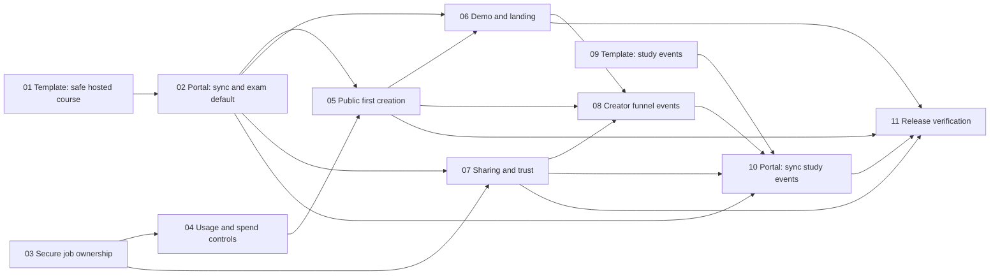

# Study with AI — implementation plan by pull request

**Status:** implementation draft, 14 November 2026  
**Product source:** [PRD](../../product/prd.md) and [launch-plan review](../../product/launch-plan-review.md)  
**Target:** public free launch for university exam preparation in English and Romanian.

## Decision: extend the prototype

Use `playground-portal` and `playground-template`. The prototype already creates courses from text-readable PDF/TXT/Markdown, supports outline review, hosts unlisted course JSON, and includes quizzes, recall, editing, deletion, and an optional exam. A rebuild would repeat the riskiest work while leaving the public-launch gaps unsolved. The gaps are access-code removal, abuse and spend controls, safe course presentation, a real demo, trustworthy sharing, and measurement.

This is a **separate launch workstream**, not an instruction to advance or edit `playground-portal/docs/NEXT.md`. Before implementation, the owner should choose whether to pause, complete, or integrate the active engineering package. That scheduling decision does not block writing or reviewing this plan.

## Rules for every implementation agent

1. Work in **one repository per PR**. Start from the latest intended base branch, inspect `git status -sb`, `git branch --show-current`, and `git log --oneline -8`. Read this PR card, its **Read first** files, and relevant tests only. Do not preload the entire PRD or repository. If a card and code disagree, stop and record the conflict rather than silently redesigning the scope.
2. Follow the workspace `AGENTS.md`: tests first and failing before implementation, then `npm run lint && npm test` in the changed repo; run `npm run build` for routes, headers, iframe/shader loading, or config changes. Use `PORTAL_FAKE_MODEL=true` for verification. Never call the real model without the owner's explicit request. Perform the manual check on the card.
3. Do not edit `playground-portal/vendor/` by hand. A template PR is followed by a portal sync PR using `npm run sync:core` and the template commit SHA. Never commit course JSON to GitHub; courses live in private Blob storage and are served from `/courses/<key>/`.
4. Keep provider/model names, token counts, costs, internal storage paths, and stack traces out of creator and learner screens. Never read `.env*` files or change provider/deployment settings. No PR in this plan pushes or merges `main`; follow the workspace release rules when a package is ready.
5. Treat every course URL as **unlisted and readable by anyone with the link**. Treat job URLs, owner-management URLs, and owner tokens as sensitive. Never put raw notes, answers, filenames, titles, private links, or credentials in analytics.

**Branching:** PRs in the same repository start from the most recently merged prerequisite. The **Read first** lists are navigation hints, not permission to expand scope. The owner can assign independent cards in parallel, but agents must rebase before merge. A PR should remain small enough to review its behavior and tests in one sitting.

## Dependency map

**Parallel work:** 01 and 03 may start from the current code independently. Work on 09 may start alongside 01, but it rebases and merges after 01. 07 can start after 02 and 03 while 04–05 are being built. 06 follows 05 so its allowance copy matches the live policy. 08 can be specified early but merges after 05–07 so event names match final flows. In the portal, 03 → 04 → 05 is serial because all touch job creation and authorization. The final release PR merges last.

## PR 01 — Make shared courses safe for portal hosting

**Repo:** `playground-template`. **Depends on:** none. **Goal:** a host can render a generated course without the key-requesting assistant or claims that only fit the owner's original course.

**Read first:** `core/site.ts`, `src/screens/{SiteShell,HomeScreen,LectureScreen,ExamScreen}.tsx`, `src/components/layout/{SiteHeader,SiteFooter}.tsx`, `core/generate/finish.ts`, `tests/{site-shell,generate-finish,screens}.test.*`.

**Implement:** Add a small, typed host configuration to the shared renderer for a portal brand label and assistant-off mode; preserve standalone template defaults. Ensure *both* lectures and the exam obey assistant-off mode. Replace unconditional home-page copy and links that promise an “Expected at the exam” page, open questions, or course-specific principles when those data are absent. Render exam navigation only if an exam exists. In `finishCourse`, emit an exam only when the exam option is on **and** the assembled lectures contain enough valid questions; use a named threshold constant and a deterministic test. Suggested initial threshold: **five questions across at least two lectures**, subject to owner review before merge. No new AI calls.

**Acceptance:** A portal-hosted course never shows a provider/key connection UI. A course without exam or expected data has no broken link or unsupported feature claim. A course with enough questions has a clearly labeled timed practice exam assembled from lecture questions. Standalone template behavior remains covered by tests. Manually render one course with and one without exam on a phone-width viewport.

## PR 02 — Sync the renderer and set the exam default

**Repo:** `playground-portal`. **Depends on:** 01 merged in template. **Goal:** adopt the shared host contract and make exam practice the normal path for new courses.

**Read first:** `scripts/sync-core.mjs`, `app/courses/[key]/layout.tsx`, `components/create/Builder.tsx`, `messages/{en,ro}.json`, `tests/{core-vendor,site-vendor,course-routes}.test.*`.

**Implement:** Run `npm run sync:core` from the merged template SHA and use the new host options in the portal course layout. Set exam mode on by default in the creator form while allowing the creator to turn it off. Explain in EN/RO that practice appears only when enough usable questions were made and that scores are practice feedback. Make the public course header say “Study with AI.” Include a regression assertion that the portal-hosted exam page has no assistant. Keep the management UI separate from the learner UI.

**Acceptance:** A new fake-model course requests exam mode by default; low-question courses omit the exam gracefully. Existing courses remain readable. Public course pages show the product brand and no model/key controls. Manual check: create a fake-model course and navigate home, lecture, and exam or its absence.

## PR 03 — Separate job status from owner authority

**Repo:** `playground-portal`. **Depends on:** none. **Goal:** a leaked job-status URL must not reveal a course-management URL.

**Read first:** `lib/api/handlers.ts`, `lib/jobs/{state,steps}.ts`, `app/api/jobs/[id]/*`, `app/jobs/[id]/page.tsx`, `lib/auth/session.ts`, `tests/{jobs,routes,manage-actions}.test.ts`.

**Implement:** Require creator authority on **all** job status and mutation endpoints, since status and outlines can reveal private course details. A job ID alone is insufficient. For signed-in creators, check the stored owner ID; for guests, issue a separate short-lived, HttpOnly creator capability cookie at job creation and validate it server-side. Store only a hash of that capability. Return `manageUrl` only to the verified creator after publication. Keep the guest capability out of share links, telemetry, referrers, and logs. For legacy anonymous jobs with no verifiable capability, fail closed on job and manager-link recovery while retaining published-course reading. Document the authorization contract in tests.

**Acceptance:** Anyone with a course URL can read the course but cannot manage it; someone with only a job ID cannot retrieve job details or `manageUrl`; the creator can still resume and manage the course after a reload in the original browser. Tests cover unauthorized status and mutation requests, signed-in and guest creators, and legacy jobs. Manual check: open the job URL in a clean browser profile.

## PR 04 — Reserve quota and estimated spend before generation

**Repo:** `playground-portal`. **Depends on:** 03. **Goal:** public access can be turned on without concurrent requests bypassing all limits.

**Read first:** `lib/api/handlers.ts`, `lib/guard.ts`, `lib/settings.ts`, `lib/jobs/{store,steps,runtime}.ts`, `lib/model.ts`, `app/admin/{actions,SettingsForm}.tsx`, `tests/{guard,jobs,settings,admin-overview}.test.ts`.

**Implement:** Add server-side, atomic reservations using `Store.create` for global and account quotas; compensate partial reservations on failure. Scope a client-generated idempotency key to the verified creator so retries return the original job instead of taking another slot. Preserve the existing guest-first-course rule as UX, not abuse protection. Add a short-lived, privacy-safe abuse bucket based on a trusted request source and a server-side secret (never raw IP in storage). Reject high-rate submissions before creating a job, with stable safe error codes and a retry time. Add operator-controlled **global and per-creator** estimated spend ceilings for each UTC calendar month, with a reserve-before-work decision and reconciliation from actual model usage, including retries and failures. Use the verified account ID for signed-in creators and the guest capability plus abuse bucket for guests; document that a guest can evade a browser-based identity. Public generation must fail closed when the global ceiling is unset. Admin can pause new generation and inspect aggregate reservations/spend without source content. Existing courses remain readable when creation is stopped. Document that an application estimate is not a provider billing guarantee; account for in-flight reservations.

**Acceptance:** Concurrent fake-model requests cannot exceed configured reservation slots; a failed or retried job cannot silently consume another full allowance; either global or creator cap exhaustion stops new work with a safe message; admin pause works without blocking course reading/deletion. Unit tests use the memory store's atomic-create behavior and concurrency cases. Manual check: set a tiny test cap locally, submit two requests, and observe the second rejection without a real model call.

**Configuration needed from owner before public traffic:** an abuse-hash secret, global and per-creator currency-denominated spend ceilings, and pricing assumptions/monitoring. Implementation agents may add documented configuration *names* but must not create or change provider settings or secrets.

## PR 05 — Open the first course and explain limits

**Repo:** `playground-portal`. **Depends on:** 02 and 04. **Goal:** any visitor can create one course without a code or sign-in, then sign in for more.

**Read first:** `lib/api/handlers.ts`, `lib/guard.ts`, `lib/settings.ts`, `components/create/Builder.tsx`, `app/create/page.tsx`, `messages/{en,ro}.json`, `tests/{jobs,guard,messages}.test.ts`.

**Implement:** Make `accessCode` optional for the normal public path; retain invite codes only as optional campaign overrides if they do not bypass spend controls. Change the generation gate so the public path does not require `PORTAL_ACCESS_CODE`; it still requires generation enabled, unpaused, and the PR 04 spend configuration. Remove the required code field from the normal form. Fetch and show the live allowance and active file/page/text limits *before* submission. Keep browser extraction and server-side `checkMaterials`. Explain scanned/empty PDF failure, no OCR, how text is sent/retained, and what “keep my files” does. On a second guest attempt, give a direct sign-in path and never imply that clearing a cookie is a valid extra allowance. Use translated safe error codes.

**Acceptance:** A fresh guest with no code can submit once; a second guest creation is blocked with a sign-in action; a signed-in creator can submit within the configured allowance; pause/cap/rate errors remain distinct and localized. Invalid material consumes no reserved job. Manual check in EN and RO at desktop and phone widths, with valid TXT and a scanned PDF.

## PR 06 — Provide an authentic demo and honest landing

**Repo:** `playground-portal`. **Depends on:** 02 and 05. **Goal:** show the actual study result before asking for material.

**Read first:** `app/page.tsx`, `app/landing.module.css`, `components/landing/*`, `lib/settings.ts`, `app/admin/{actions,SettingsForm}.tsx`, `messages/{en,ro}.json`, `tests/{settings,messages,course-routes}.test.ts`.

**Implement:** Add a `demoCourseKey` setting selected by an admin from an existing course, validate that the course exists, and render a prominent demo CTA only when configured. The demo course stays as JSON in private Blob like every other course; do not commit its content. The owner must create/select content they can publicly share. Show real output examples, actual input types and active allowance, the editable outline, and the timed practice exam only if the selected demo actually has one. Remove tutor, automatic mastery, and official grading implications. Keep EN/RO claims equivalent and retain a clear create CTA.

**Acceptance:** The demo CTA reaches a real unlisted course without sign-in or code; no broken CTA appears when unconfigured; screenshots/claims match that course and current feature flags. Manual check both locales and mobile. **Owner action before launch:** provide a permitted demo course and select it in admin.

## PR 07 — Make sharing, reporting, and deletion explicit

**Repo:** `playground-portal`. **Depends on:** 02 and 03. **Goal:** creators know what sharing grants and learners have a content-report path.

**Read first:** `app/jobs/[id]/page.tsx`, `app/courses/[key]/layout.tsx`, `app/manage/[token]/*`, `app/my/[key]/*`, `lib/sites/{store,library,page}.ts`, `app/admin/*`, `messages/{en,ro}.json`, `tests/{manage-actions,course-routes}.test.ts`.

**Implement:** Provide a course-only copy action and adjacent disclosure: anyone with the link can view; creators must have rights to share source-derived content. Keep owner management links in a distinct action with a warning. Add a minimal content-report route/form that stores only report category, course key, optional reply contact, timestamp, and status in private storage; never store the course text in the report. Give admin a report queue and existing takedown action. Expose a visible delete path for guest and signed-in owners. Verify deletion removes course, versions, kept sources, owner lookup, and account marker, and that removed pages return 404. Add privacy/terms pages whose factual data-flow claims are checked against code; final legal text requires specialist/owner approval before broad EU launch.

**Acceptance:** Shared clipboard content contains no owner/job token; unlisted/noindex semantics remain; report reaches admin; takedown and owner deletion work; deleted content is no longer served. Tests include a token-leak check and deletion cascade. Manual check share, report, and delete using separate browsers.

## PR 08 — Instrument the creator funnel safely

**Repo:** `playground-portal`. **Depends on:** 05, 06, and 07. **Goal:** measure where valid creation succeeds or fails without collecting study material.

**Read first:** `lib/log.ts`, `lib/api/handlers.ts`, `lib/jobs/steps.ts`, `app/page.tsx`, `components/create/Builder.tsx`, `app/jobs/[id]/page.tsx`, `lib/settings.ts`, `tests/{log,jobs,routes}.test.ts`.

**Implement:** Define a typed event allowlist and shared schema for `landing_view`, `demo_open`, `create_start`, `material_validated`, `job_submitted`, `outline_view`, `outline_confirmed`, `generation_failed`, `course_published`, and `share_clicked`. Record server events at authoritative transitions; client events need explicit consent and a bounded first-party intake route. Use coarse error codes, locale, timestamp, and pseudonymous IDs only. Set event retention and purge behavior. Produce an admin or script summary with numerator and denominator for valid-job success and each funnel step, plus published courses per active creator and a seven-day creator-return cohort; mark missing consent as missing data, not failure. Treat copy clicks as intent to share, not proof of an actual share.

**Acceptance:** Malformed and over-sized events fail validation; fixtures containing notes, filenames, titles, answers, URLs, model IDs, or credentials cannot enter analytics. Published counts are idempotent across retries. Consent-off browsing causes no optional client event. Manual check the fake-model funnel and inspect only schema fields in a local test store.

## PR 09 — Expose privacy-safe study activity hooks

**Repo:** `playground-template`. **Depends on:** 01. **Goal:** the portal can observe learning actions without coupling the standalone template to a portal endpoint.

**Read first:** `src/site/context.tsx`, `src/widgets/core/MockExam.tsx`, quiz/recall/review components found with `rg -n 'completed|onSubmit|onFinish' src`, `tests/{widgets,screens,site-shell}.test.*`.

**Implement:** Define a typed browser `CustomEvent` contract at the shared site boundary for `course_open`, `quiz_completed`, `recall_completed`, `review_completed`, and `exam_completed`. Dispatch only event type and an opaque course key; no question IDs, titles, content, scores, or answers. A standalone course may dispatch events with no listener and must behave as before. Do not perform network calls inside the template; the portal owns consent and transport. Use a client component for `course_open`, since the shell itself renders on the server.

**Acceptance:** Each user action emits once; page reload does not invent completions; absence of a listener causes no request/error; tests cover one quiz and one exam completion. Manually complete a quiz and exam in the template fixture.

## PR 10 — Sync study hooks and complete measurement

**Repo:** `playground-portal`. **Depends on:** 07, 08, and 09. **Goal:** connect actual study actions to the consented event intake.

**Read first:** `scripts/sync-core.mjs`, `app/courses/[key]/layout.tsx`, PR 08 analytics files, `messages/{en,ro}.json`, `tests/{core-vendor,site-vendor,course-routes}.test.*`.

**Implement:** Sync the exact merged template SHA. Mount a small client listener under the course layout and send allowlisted events only after the user has opted in. Add a visible EN/RO consent preference and a way to change it; it must not be bundled with the course's essential local progress storage. Mark shared-link arrivals without putting private URLs or owner tokens into telemetry. Report weekly active studying browsers as browser estimates, never unique people or cross-device progress.

**Acceptance:** Consent off produces no study event; consent on records an allowed event with only coarse fields; a shared course can be studied without consent. Manual check a quiz, recall action, and exam on a phone-width browser.

## PR 11 — Codify the launch gate

**Repo:** `playground-portal`. **Depends on:** 05–08 and 10. **Goal:** give the owner a reproducible go/no-go check and a safe rollback route.

**Read first:** `README.md`, existing tests, PR 04 admin controls, PR 08 metrics summary, `app/api/cron/cleanup/route.ts`. **Likely file:** `docs/launch-runbook.md` plus focused smoke tests/scripts only if the gate cannot be run from existing tests.

**Implement:** Document the exact fake-model smoke sequence (guest create → outline → publish → study → share → report → delete), quota/cap concurrency check, job-link privacy check, consent-off check, EN/RO and phone/keyboard checks, and cleanup verification. Add a sampled content-quality check: source labels point to supplied material, quiz and exam answers are defensible, and unsupported claims can be reported. Include the operator pause/rollback steps that preserve reading and deletion. Record expected monitoring signals and the first-cohort interview script, including whether the student would pay and what outcome they would pay for. If the audit finds a code defect, fix it in a separate bounded PR rather than hiding it in this runbook PR.

**Acceptance:** The full gate passes in every modified repo: `npm run lint && npm test && npm run build`. A person unfamiliar with the implementation can run the smoke sequence with the fake model and record pass/fail. No real model call is part of automated verification. Public promotion waits for the owner-controlled items below.

## Owner-controlled decisions and release sequence

These are **release inputs**, not invitations for an agent to change provider settings or invent legal consent:

| Input | Needed by | Working proposal |
| --- | --- | --- |
| Exam threshold | PR 01 merge | Five valid questions from at least two lectures; revise after a few real courses. |
| Signed-in and global allowance | PR 05 copy / launch | Keep existing signed-in five per UTC day as a ceiling; choose the global daily limit after a fake-model load test and measured cost. |
| Estimated spend ceilings and abuse-hash secret | PR 04 deployment | Owner sets global and per-creator values in approved deployment/admin settings; public creation stays closed when the global value is unset. |
| Public demo content and rights | PR 06 launch | Owner supplies a purpose-created or licensed course and checks every source/claim. |
| Privacy/terms wording and consent basis | PR 07/08 launch | Qualified review before broad EU traffic. |
| Launch ramp and report owner | PR 11 launch | Invite 20–30 students, observe at least 15–20 sessions, review failure/cost/quality, then widen EN/RO promotion. |

After PR 11, run a **small student cohort** before broad acquisition. Record actual generation success, time to course, first study action, return, sharing, reports, published courses per active creator, and estimated cost per published course. Choose the next feature from those observations. The service-backed tutor, automatic weakness inference, payments, and public discovery remain outside this launch plan.

## Coverage of the colleague's business and launch suggestions

The 11 PRs are the **software needed for a credible free launch**. The pasted proposal also contains marketing tasks, unvalidated prices, and larger feature bets. They need owners and decision gates, but putting all of them into the launch-critical PR chain would delay the first evidence of use.

| Suggestion | Where it is handled | Decision or missing evidence |
| --- | --- | --- |
| Exam-focused positioning, one upload → interactive course → shareable link | PR 01, 02, 06, 07 | Test copy with students; do not promise an AI tutor or automatic weakness diagnosis at launch. |
| No learner account, own materials, interactive exercises, unlisted sharing | Existing prototype; PR 02, 05, 07 verify the public flow | Course link grants read access. |
| Source-traceable answers and content trust | Existing source labels; PR 07 reporting and PR 11 sampled quality review | A source label is evidence to inspect, not a correctness guarantee. |
| Realistic mock exams, multiple difficulties, open questions, topic breakdown | PR 01–02 make the existing timed question-based exam visible and honest | Separate question generation, open-answer grading, and topic-level diagnosis need quality research first. |
| AI weakness detector and targeted extra exercises | Outside launch PRs | Existing difficult-parts review is manually flagged; pilot guided practice from missed questions before promising reliable diagnosis. |
| “Ask Your Course” with citations | Outside launch PRs | Current learner assistant requests a provider key; PR 01–02 hide it. A later server-backed tutor needs source grounding, permissions, rate limits, and cost tests. |
| Smart revision and collaboration | Existing manual revision; collaboration later | Check whether students return for revision before building automated scheduling or group editing. |
| Free, Student, Power Student tiers and credits | Pricing research below; no payment PR yet | Prices of €4.99–6.99 and €9.99 are hypotheses. Test willingness to pay and full unit cost first; avoid per-question charging in the learner experience. |
| Access codes, ambassadors, referral codes | Optional invite codes already exist; launch is public without a code | Use codes for research cohorts or extra allowance only. Referral attribution is a later experiment after consent and funnel measurement. |
| Global and per-user AI budget | PR 04 | Owner sets ceilings from measured cost; estimated application spend is not a billing guarantee. |
| Real demo, 2–3 examples, screenshots/video, consistent brand | PR 01, 02, 06 guarantee one permitted live demo | Produce a second or third example only when it teaches a distinct subject/use case and rights are clear. Record actual output; do not fabricate product results. |
| TikTok/Reels/Shorts, student communities, SEO, branded course footer | Founder-led experiments below | Product demonstrations and community feedback start after the launch gate. A branded footer and referrals are optional experiments after privacy/attribution review; SEO pages follow observed search intent. |
| First 100–200 active students, return/share/pay interest | PR 08–10 metrics plus cohort interviews below | Treat numbers as experimental goals, not evidence or release gates. “Active” must be defined as a study action, not a visit or follower count. |

### Non-code validation work, in launch order

1. **Before promotion:** Select one rights-cleared demo course, capture its real upload/outline/study flow, prepare 5–10 short scripts, and make a simple cost sheet covering AI calls and retries, Blob storage, hosting, support, abuse, and eventual payment fees. Use the actual provider invoice and operational data to revise the sheet. Confirm a named owner for reports, privacy requests, and student interviews.
2. **First cohort:** Invite 20–30 university students; observe at least 15–20 creation or study sessions. Ask what exam they are preparing for, where the course is inaccurate or unhelpful, whether they shared it, whether they returned, and what they would pay for. An optional invite code may label the cohort; it is not required for public creation. Record permission before using any course or student quote in marketing.
3. **Measured public ramp:** Publish real product demonstrations, starting with a few videos rather than committing to a fixed cadence. Cross-post suitable clips to TikTok, Reels, and Shorts; contact relevant student communities with a useful sample rather than generic advertising. Track origin with privacy-safe campaign tags. Try a 4–5-video week only if production capacity and early response justify it. Keep paid advertising out of the initial validation budget unless the owner chooses otherwise.
4. **30-day decision review after the launch gate:** Review generation success, first study action, seven-day return, share-action rate, published courses per active creator, reports, cost per successful course, and student comments. Explore a goal of 100–200 **weekly active studying browsers** only after confirming acquisition capacity; it is a browser estimate, not a count of people. Investigate willingness to pay before choosing credits, monthly allowances, or the illustrative price tiers. Review conversion percentages with denominators and cohort sizes.

### Conditional follow-on PRs, not part of the free-launch gate

Each becomes a scoped PR card only after its entry evidence exists; no agent should implement it from this paragraph alone.

| Candidate | Entry evidence | First bounded experiment |
| --- | --- | --- |
| Guided weak-topic practice | Missed-question and manual-review usage plus interviews show a repeat problem | Recommend existing relevant lecture sections and questions; test comprehension before generating new exercises. |
| Better exam simulation | Students use the existing exam and identify a concrete gap | Add one assessed format or topic breakdown with a validated rubric; do not claim official grading. |
| Source-grounded course tutor | Students ask for it, source permissions are clear, and a per-user cost envelope is known | Small server-backed Q&A trial with citations and insufficient-evidence responses. |
| Referral and footer attribution | Shared-link arrivals can be measured with valid consent | Test a subtle “Made with Study with AI” link and unique ambassador referral codes; measure activated students, not clicks alone. |
| Pricing and billing | Retention, willingness-to-pay interviews, and full unit cost support a paid offer | Trial one simple free allowance plus paid monthly usage limit; keep ordinary study/review interactions free of micro-charges. |
| Collaborative corrections | Multiple study groups request it and moderation ownership is clear | Try owner-reviewed correction suggestions before shared editing. |

## One-card agent handoff template

> Implement PR **NN** in **repo**. Read only `AGENTS.md`, this PR card, its `Read first` files, and tests directly relevant to them. Start from **base SHA/branch**. Follow tests-first and fake-model rules. Do not edit `vendor/` directly, read `.env*`, call the real model, or change provider settings. Keep the PR's goal and acceptance checks exact. Report changed files, failing-first test evidence, lint/test/build results, manual check, and any plan/code conflict. Stop after a reviewable PR; do not merge it.

The coordinator fills in the current base SHA and PR number. This packet is deliberately short so each agent can work without loading unrelated product and repository history.
