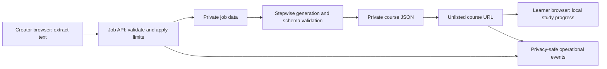

# Study with AI — Product Requirements Document

**Product:** Study with AI  
**Product type:** Responsive web application for creating and studying shareable courses  
**Owner:** Product owner (name to add)  
**Status:** Draft for review; not an implementation authorization  
**Version / updated:** 0.1 / 14 November 2026  
**Release in scope:** Public free launch  
**Evidence basis:** Repository inspection and owner answers in this conversation. The live deployment was unreachable from this session. No student interviews, live analytics, or cost baseline were supplied.  
**Related document:** [Launch plan review](launch-plan-review.md)

**Evidence labels used below:** **Observed** means present in the checked-out prototype; **Decision** means confirmed by the owner; **Proposal** means a requirement or target for review; **Unknown** means it needs evidence or an owner choice.

## 1. Executive summary

### Vision and strategic alignment

**Vision:** A university student can turn their own course notes into an interactive study website, practice before an exam, and share an unlisted course link with classmates.

**Primary user:** A university student with lecture PDFs or notes who needs to understand and practise material before an exam. **Decision:** Public messaging will prioritize English and Romanian; the course generator can handle additional languages already supported by the prototype.

**Core value:** A structured course with explanations, quizzes, recall cards, interactive exercises, and optional exam practice from supplied material, available at one link. The promise is useful practice and understanding, not a guaranteed grade improvement. **Proposal:** The first release should emphasize the existing course and practice experience; “AI tutor” copy waits for a compliant tutor experience.

**Business objective:** Establish whether students create a course, study with it more than once, and share it. **Decision:** Launch free and open to anyone, with clear limits and a guest first course. Ask guests to sign in for additional courses. The first public promotion targets a broad English and Romanian audience. Growth has priority over aggressive cost minimization, but an enforceable spend stop is still necessary. Monetization is a later decision.

**Success definition:** A measurable cohort of creators completes the upload → course → study loop, and classmates use shared courses. The primary launch metric is **weekly active studying browsers**: distinct privacy-safe browser identifiers with at least one completed quiz, recall session, difficult-parts review, or mock exam in a seven-day window. This estimates learner activity; it does not count unique people across devices. Because today's study progress is browser-local, this metric requires new consent-aware event collection. Track creator activation separately (defined in section 8).

**Market context:** Eurostat counted approximately [19.1 million tertiary students in the EU in 2024](https://ec.europa.eu/eurostat/statistics-explained/SEPDF/cache/1152.pdf?v=5016995364981757). This is a broad population indicator, **not** a serviceable market or revenue forecast. The reachable audience for an English/Romanian free launch is unknown. [Quizlet offers AI practice tests from uploaded notes](https://help.quizlet.com/hc/en-us/articles/25946589648013-Studying-with-Practice-Tests), and [Google's notebook product offers source-based flashcards and quizzes](https://support.google.com/gemininotebook/answer/16958963). The differentiating hypothesis is the combination of an editable course website, interactive learning content, and an unlisted link classmates can use without an account. This needs user validation.

### Resources and milestones

**Proposal, for sizing rather than commitment:** One full-stack developer with product/design support and part-time student research/QA; roughly 3–6 weeks from kickoff to a public free launch after configuration and legal/privacy review. This is a range because deployed behavior, generation cost, abuse patterns, and design quality have not been measured. No new paid plan or native app is included. A release may take longer if the tutor UI, content rights, or open access controls need structural changes.

## 2. Problem and opportunity

### Problem statement

Students receive fragmented lecture slides and notes, then manually convert them into summaries and questions. Near an exam, they need to know what they understand, practise retrieval, and revisit weak material. A generic summary can feel useful without testing knowledge. Sharing an entire set of source files with classmates can also be awkward or unauthorized.

The prototype demonstrates a possible solution; it does not prove the size of the problem, learning benefit, or willingness to pay. **Unknown:** time students currently spend preparing, whether they prefer this format to existing tools, and the quality of generated courses from diverse real materials. The first research cohort must measure these rather than assume them.

### Opportunity and competitive gap

The immediate opportunity is a narrow wedge: students with text-readable university lecture material who are preparing for an exam and want a course they can revisit and share. The launch should test whether a **course website** is more useful than separate flashcards, notes, and quiz generators. It should also test whether a classmate who opens a shared course becomes a creator. The number of potential users, acquisition cost, and revenue per user are unquantified.

### Outcomes sought

1. A first-time visitor can understand the output before uploading and create a first course without an access code or account.
2. A creator can review the outline, finish generation, and study the resulting course.
3. A learner can practise and return to the same course link on the same device; the product explains where progress is stored.
4. A creator can knowingly share an unlisted course link and remove a course later.
5. The operator can see failures and costs, stop generation when needed, and respond to abuse or takedown requests.

## 3. User requirements and stories

### Personas

| Persona | Goal and context | Current friction | Successful experience |
| --- | --- | --- | --- |
| **Exam-preparing creator** (primary) | Has one or more lecture PDFs/notes and an exam date; wants a practical study path. | Material is long or uneven; turning it into questions takes time; generated output may be wrong. | Understands upload rules, reviews the outline, gets a usable course, completes a practice activity, and knows how to edit or delete it. |
| **Classmate learner** (primary distribution) | Opens a shared link to study a course. | Does not want account setup; may not know whether content is trustworthy or current. | Can start reading and practising immediately, see source labels where available, and understand that progress is local to their device. |
| **Course owner returning later** (secondary) | Wants to fix an error, add materials, or revisit a course. | May lose a private management link or not understand version changes. | Can recover owned courses through optional sign-in, revise with clear limits, and delete content. |
| **Operator** (internal) | Needs reliable public service and controlled cost. | Open generation can be abused; generation failures are expensive and hard to diagnose. | Can observe funnel and costs without seeing private study content, pause creation, and remove an abusive course. |

These are design personas, **not** findings from interviews.

### Journey

**Current prototype:** Landing page → `/create` → local file text extraction → access code → job planning → possible clarifying questions → outline/design choice → generation → course URL and private manage URL → course study. Optional Google sign-in provides owned courses and later revisions. A course reader need not sign in. **Observed:** `app/page.tsx`, `components/create/Builder.tsx`, `app/jobs/[id]/page.tsx`, `app/courses/[key]/`, `app/my/`.

**Proposed public journey:** Landing page with a real demo → guest uploads readable material after seeing limits and sharing implications → optional goal/exam date → outline review → generation progress and clear recovery → course homepage with an obvious first study action → quiz/recall/exam practice → copy unlisted link → return or sign in to manage more courses. The guest's first creation must not require Google sign-in.

### Core stories and acceptance criteria

| ID / priority | Story | Testable acceptance criteria |
| --- | --- | --- |
| U1 / Must | As a visitor, I want to inspect a real course before providing my notes. | Landing page opens an accessible demo course without login, code, or upload. Demo content is licensed or created for this purpose. The demo visibly includes explanation and practice. |
| U2 / Must | As a guest creator, I want to make my first course with understandable limits. | A new visitor can start one course without code or sign-in; the form states file types/size and current free allowance before submission; limit errors say when/how the person can continue. |
| U3 / Must | As a creator, I want to check the structure before time-consuming generation. | The outline appears before lecture generation; creator can select a design, rename/remove lectures, and cannot submit an empty outline. |
| U4 / Must | As a student, I want to practise for an exam using the course. | The course exposes a quiz and recall activity where generated data supports them; exam practice is clearly visible when available; results include explanations and label scores as practice feedback. |
| U5 / Must | As a creator, I want to share the result knowingly. | The product explains that anyone with the link can view the course; creator has a one-click copy action; no source content is placed in a public index or gallery by default; creator can delete the course. |
| U6 / Must | As a learner, I want to check the basis of generated statements. | Source file/page labels are shown where source metadata exists; unsupported content is not presented as verified; there is an easy way to report a content error. |
| U7 / Must | As a learner, I want a coherent experience on a phone. | Upload, outline review, reading, quiz, revision, sharing, and deletion are usable at common phone widths with keyboard and screen reader support. |
| U8 / Should | As a returning creator, I want my courses in one place. | Optional sign-in associates owned courses and exposes existing edit/restore/delete actions; a guest can claim a course from the management link. |
| U9 / Later | As a learner, I want to ask about my course. | A future tutor answers from permitted course content, cites a useful passage, says when evidence is insufficient, and reveals no provider/model/cost information. No learner API key is needed. |

## 4. Product requirements

### Must have for public free launch

**PR-01 — Honest landing and demo.** Show the problem, the actual creation steps, a genuine demo course, sample output visuals, supported inputs, free allowance, and the distinction between generated practice and official exam assessment. Keep EN/RO copy equivalent. Avoid tutor claims until PR-09 is ready. The demo must not contain another student's material or private lecture content.

**PR-02 — Open first creation with abuse controls.** Remove the access-code requirement for ordinary public creation; preserve optional invite codes for campaigns or higher allowances if useful. Allow a guest first course, then ask the guest to sign in for additional courses. Show allowance before upload and enforce it on the server. **Unknown:** exact daily/monthly allowances; choose them after load and cost tests. Existing one-per-browser guest cookie is a user-experience limit, not a durable abuse defense. Include rate controls, bot/automation mitigation appropriate to measured abuse, and an operator-controlled global monetary stop. When creation stops, existing courses remain readable.

**PR-03 — Reliable material handling.** Accept text-readable PDF, TXT, and Markdown. Preserve the current browser-side extraction and no-original-file upload behavior unless a reviewed change is needed. Current prototype limits are 12 files, 400 pages, 600,000 extracted characters, and a 4 MB request body; surface the active limits before submission and enforce them before and on the server. For scanned or empty PDFs, explain the issue and next action. Do not claim OCR support. Make the fate of uploaded text and opt-in kept files clear.

**PR-04 — Outline and generation.** Keep the existing context questions only when needed; show a recommended structure and alternatives where produced; permit lecture rename/removal before writing. Display actual progress, a meaningful retry/recovery path, and a stable job link. A generated course must pass schema/content validation and have at least one lecture. A failed generation must not count as a successful course in metrics or billing analysis. Do not show internal error traces.

**PR-05 — Exam-ready study course.** A course page offers explanations, recall, lecture quizzes, and available exercises. **Decision:** Exam practice is visible and enabled by default when enough valid questions can be generated; otherwise explain why it is absent. The current timed mock exam reuses lecture quiz questions. State this honestly and do not promise open-ended grading. Feedback should point back to the relevant lecture and indicate that generated answers may be mistaken. The existing difficult-parts hub remains a **manual flag and review** experience, not automatic mastery diagnosis.

**PR-06 — Unlisted sharing and ownership.** A course is reachable by its link but absent from public discovery by default. The share UI states that anyone with the link can read it and that the creator is responsible for permission to share source-derived content. Provide a copy-link action, creator deletion, operator takedown, and a clear path to report content. A management link is more sensitive than the course link and must never be included in share actions or public analytics. Verify that course URLs do not expose source uploads or owner tokens.

**PR-07 — Trust, privacy, and rights.** Explain the data flow before submission: text extracted locally, sent for generation, temporarily stored, then removed according to the actual retention behavior; saved source material is opt-in. Publish a privacy notice and terms appropriate for a public EU-facing service after specialist review. Provide content deletion and account deletion that can be tested. Give learners a visible AI-content caution and error-report route. Do not publish source documents or student work in a demo or campaign without permission.

**PR-08 — Measurement and operations.** Instrument section 8's funnel and study events with minimal pseudonymous identifiers. Do not record source text, generated answers, private links, provider credentials, or exact quiz answers in analytics. Monitor generation success/failure, latency, estimated cost, and abuse. Expose operator controls for pause, quotas, and takedown. Use consent/legal review to decide which analytics can run before opt-in.

**PR-09 — Learner-facing compliance gate.** The existing assistant UI cannot be presented as the Study with AI tutor while it requests a provider API key or shows provider/model names. Hide it on public courses until a reviewed service-backed design meets the workspace rules, or ship it later. Audit all public creator and learner screens for model names, token/cost details, internal filenames, and stack traces. Source *file names used as citations* are an exception only when they come from the user's material and are intentionally displayed as study references; internal storage paths are never shown.

### Should have after basic launch evidence

- **SH-01 — Guided practice from missed questions:** Use wrong quiz answers and manually flagged difficult parts to suggest existing course sections and questions. Validate that students understand these suggestions; label them as suggestions, not precise mastery scores.
- **SH-02 — Source-grounded tutor:** Server-mediated Q&A with citations, insufficient-evidence behavior, rate limits, and privacy/cost review. Estimate effort only after scoping retrieval and permissions.
- **SH-03 — Better creator recovery:** Clear resume path for unfinished jobs, lost-link guidance, and account claim prompts at the right time.
- **SH-04 — Growth experiments:** Landing copy tests, referral attribution, and a subtle “Made with Study with AI” link on courses only after attribution/privacy requirements are settled.

### Could have later / outside this release

Automatic weakness inference, newly generated targeted exercises on demand, collaborative editing/comments, public course discovery, payment plans, mobile apps, and open-ended AI grading. These each add cost, moderation, privacy, or research demands. None is required to test the core launch hypothesis.

### Prioritization and dependencies

| Workstream | User value | Effort estimate | Depends on |
| --- | --- | --- | --- |
| Demo + honest landing + exam visibility | High | Small to medium | Legally usable demo content, current feature audit |
| Open creation + quotas + spend stop | High | Medium to large | Deployment configuration, abuse/cost model |
| Share/rights/deletion clarity | High | Medium | Privacy/rights review and owner flow |
| Funnel and study measurement | High for decisions | Medium | Analytics design and consent decision |
| Generation quality and mobile fixes | High | Variable | Real student sessions and error samples |
| Service-backed tutor | Potentially high | Large | Provider service design, citation design, rate/cost controls |

These estimates are relative because no live performance or issue backlog was available.

## 5. Technical specifications

### Current architecture, observed

The portal is Next.js 16/React with server routes and a shared TypeScript/Zod course generator and renderer vendored from `playground-template`. The browser extracts PDF text; `POST /api/jobs` stores a generation job; subsequent requests advance one step at a time; generated JSON is validated and stored in private Blob storage; `/courses/<key>/` renders a course. Optional Google sign-in links courses to an owner. An admin area manages generation, invite codes, and course removal. No relational database is present. See `playground-portal/README.md`, `lib/api/handlers.ts`, `lib/jobs/steps.ts`, `lib/sites/publish.ts`, and `lib/jobs/store.ts`.

### API and integration requirements

| Surface | Current behavior | Launch requirement |
| --- | --- | --- |
| `POST /api/jobs` | Accepts access code, request, and extracted materials; checks limits. | Support public guest first creation without code, enforce server-side allowances and abuse controls, and return stable, localized error codes without private internals. |
| `GET /api/jobs/<id>` and `POST .../advance` | Expose state and advance generation. | Keep resumable status; protect sensitive management results from unnecessary exposure; do not include source text or credentials in responses. |
| `PUT /api/jobs/<id>/answers`, `/design`, `/choice` | Resolve questions, outline choice, and add/reorganize choice. | Preserve validation and conflict handling; reject empty/invalid designs without consuming generation work. |
| `/courses/<key>/...` | Renders public course from stored JSON. | Maintain no-login reading and unlisted semantics; only intended content appears; instrument aggregate study actions if consent permits. |
| `/manage/<token>`, `/my/<key>` | Creator editing, revisions, versions, and deletion. | Keep management authorization separate from share URL; make deletion discoverable and verify removal. |
| `/admin` | Pause, daily limit, invite codes, overview, takedown. | Add or verify enforceable global spend/abuse controls and launch monitoring. |

**Proposed request/response contract for open creation:** `POST /api/jobs` accepts a validated `request` plus an array of extracted `materials`; `keepSources` is allowed only for a signed-in owner. The public path does not require `accessCode`. A successful submission returns HTTP 202 with `{ "id": "<opaque job id>" }`. Limit and validation failures return the existing shape `{ "code": "<stable code>", "error": "<safe sentence>" }` with appropriate 4xx/5xx status; the UI translates the code. `GET /api/jobs/<id>` returns status, progress, safe review data, and a published course URL when ready; it never returns source text. The private management URL should be delivered only through an authorized creator context or a separate creator-held secret, not through a publicly shareable status response. Exact identifiers and authorization mechanics require implementation design.

**Proposal:** Do not invent a new course database or per-course repository for launch. Add only data/services needed for limits and measurement; design any new store with deletion and retention in mind. No real AI model calls should be used during automated verification unless the owner explicitly requests them.

### Data requirements

Existing entities include `Job` (source text, request, state, progress), `Course` (schema-validated JSON and metadata), `Owner` (hashed management token or signed-in user link), `InviteCode`, and optional retained `Source`. Proposed launch entities are `UsageAllowance/RateDecision`, `SpendLedger`, `AnalyticsEvent`, and `ContentReport`, with the smallest fields needed. Course text and user answers must not enter analytics. The current data lifecycle described in `playground-portal/README.md` is: uploaded job text deleted after successful publication, job records cleaned after seven days, and opt-in retained sources deleted when disabled, course/account deleted, or otherwise governed by a documented retention rule. Verify actual deployed cleanup before claiming these periods publicly.

**Validation:** Course JSON must pass existing Zod schemas; source/page references must use valid supplied material; no generated HTML/JS should bypass the existing sandbox and security checks. Empty/scanned material, malformed requests, duplicate submissions, budget exhaustion, and interrupted jobs need explicit error states.

### Performance and capacity proposals

- Landing and demo pages: mobile p75 Largest Contentful Paint ≤ 2.5 seconds on a representative throttled network; measure with real-user data after launch.
- Upload validation: show local extraction progress immediately; reject invalid material before generation cost is incurred.
- Generation: measure median and p95 time to first usable course; propose a p95 target only after a first 20-course baseline, since model latency and course length vary greatly. Show accurate progress and a resume route.
- Reliability: ≥ 95% of valid submitted jobs should publish successfully in the first launch cohort, with failures counted separately by cause; raise the target after baseline and fixes.
- Capacity: test at least the expected first-cohort peak and verify that global rate/spend controls work under concurrent requests. The peak volume is unknown until an acquisition plan is set.

## 6. User experience requirements

**Design principles:** Show the output early; ask only for information needed to make the course useful; let students act on a concept, not merely read it; present generated content as editable and fallible; expose privacy and sharing consequences at the decision point. Keep the friendly existing tone where it does not obscure limits or error states.

**Information architecture:** Landing → demo or create → outline → generation status → course home → lecture/quiz/recall/difficult parts/exam → share/return. Creator management is separate from learner navigation. An unlisted course page must not include the private management token.

**Key screens and behavior:**

1. **Landing:** One clear primary create CTA and one demo CTA; real course preview; accurate list of features; free allowance and input types. EN/RO equivalent.
2. **Create:** File chooser/drop zone, per-file extraction feedback, limits before submission, plain-language data notice, optional goal/context, and only advanced settings that improve the result.
3. **Outline:** Recommended plan, alternatives when available, lecture rename/remove, visible assumptions, and a clear “build” action.
4. **Progress/result:** Real progress rather than a fake percentage, retry and resume, course URL and separate management URL, copy-share action, first suggested study step.
5. **Course:** Readable mobile layout, visible quiz/revision path, source labels where present, practice exam when available, local progress explanation, content report control.
6. **Limit/deletion states:** Clear reason, timing or next action, and no stack trace or internal provider detail.

**Accessibility:** Keyboard support for every creation and study action; visible focus; labels/errors linked to fields; screen reader announcements that do not overwhelm; contrast checks; reduced-motion support; touch targets fit phones. Validate against WCAG 2.2 AA as an acceptance goal, with manual keyboard/screen reader checks in addition to automated checks.

**Usability test criteria, proposed:** In a moderated first cohort, at least 80% of participants should start a demo, submit valid material, find the outline review, and complete one study activity without moderator rescue. Record the step and cause for every failure; do not treat this proposed threshold as an existing benchmark.

## 7. Non-functional requirements

### Security, privacy, and rights

- Keep provider keys and admin credentials server-side; do not expose provider/model names, token counts, costs, or internal paths in learner/creator UI.
- Separate public course access from owner management access; use appropriate authorization on edit/delete; minimize leakage through response bodies, logs, previews, referrers, and analytics.
- Apply request limits, rate controls, schema validation, content sandboxing, and secure response headers to public creation and course content. Preserve the existing sandbox for custom exercises.
- Encrypt data in transit and use provider-managed private storage at rest. Document sub-processors, retention, deletion, and data subject request handling before a broad EU launch; obtain qualified legal/privacy review for GDPR and copyright claims.
- Maintain a takedown path for unlawful or unauthorized shared material and a way to report harmful or incorrect generated content.
- Collect only the analytics needed for product decisions, with consent where required. Do not store raw notes, generated passages, typed questions, or exact assessment answers in telemetry.

### Reliability and recovery

- A job should survive a page reload or closed tab. Retries must not publish duplicate courses or consume extra allowance when the same operation is retried idempotently.
- Operator can pause new generation while course reading and deletion still work. Failed jobs expose a user-safe cause and an appropriate retry or fresh-start path.
- Verify that cleanup removes temporary job text on schedule and that deletion removes course data, retained sources, and owner links. Define backup/recovery expectations before public traffic; the current storage design has no documented recovery objective.
- Log stable operational events and alert on sustained failure, spend-stop activation, and unusual creation volume. Alerts must omit content and credentials.

### Supported platforms

Responsive modern desktop and mobile browsers; no native app or offline guarantee for portal-hosted courses. The template explicitly disables a shared service worker on the portal origin. Cross-device learning progress is not promised because current progress is stored locally in the browser.

## 8. Success metrics and analytics

### Definitions

| Metric | Definition | First review target (proposal, not benchmark) |
| --- | --- | --- |
| Qualified creator | A unique visitor who reaches create and selects valid material. | Establish baseline in first two weeks. |
| Creator activation | A new creator publishes a first course and completes at least one study activity on it within seven days. Denominator: new creators who submit a valid job. | Explore ≥ 40% after reliability fixes; revise with observed data. |
| Generation success | Published first-course jobs / valid first-course jobs started, excluding user cancellation. | ≥ 95% in the first observed cohort. |
| Time to useful course | Time from valid submit to published course; separately record time spent waiting for a user's outline decision. | Baseline first, then set p50/p95 targets. |
| Weekly active studying browsers | Distinct privacy-safe browser identifiers completing ≥ 1 study action in seven days; one person on two devices may count twice. | Upward trend across four weeks; absolute target after acquisition baseline. |
| Creator return | Activated creators with a study action on a later day within seven days of activation. | Explore ≥ 20%; interpret against exam timing. |
| Share rate | Courses whose creator uses copy-share or share action / published courses. | Explore ≥ 30%; validate with interviews because copying is not confirmed sharing. |
| Shared-link learner conversion | Distinct learners arriving on a course through a tagged share link who later start their own course / eligible tagged arrivals. | Establish baseline; no target yet. |
| Unit cost | Total generation provider cost including retries / successful published courses, plus failure cost separately. | Record before broad promotion; owner sets budget envelope. |
| Safety/trust | Content reports, takedowns, deletion completion, exposed sensitive UI incidents. | Zero known credential or private-token disclosures. |

### Event taxonomy and implementation

**Proposed events:** `landing_view`, `demo_open`, `create_start`, `material_validated`, `job_submitted`, `outline_view`, `outline_confirmed`, `generation_failed`, `course_published`, `course_open`, `quiz_completed`, `recall_completed`, `review_completed`, `exam_completed`, `share_clicked`, `course_deleted`, `content_reported`. Include timestamp, course/job pseudonymous ID where needed, locale, entry channel, and a coarse success/failure code. Do not include filenames, source text, course titles, question text, answers, private management URLs, or model details. Use a clearly documented identity/consent scheme and retention period. Current server logs cover operational events such as job creation and publication, but not this full funnel or local study activity.

**Review cadence:** Daily operational check during launch; weekly product funnel and qualitative review; 30-day decision on retention, sharing, and the next feature. Report cohort sizes and confidence/uncertainty, not only percentages. A/B tests should wait until traffic is large enough to interpret them; use direct interviews and usability tests first.

## 9. Implementation plan

This is a product sequence, not a request to bypass the active engineering plan or its repository checks.

| Phase | Scope | Exit gate |
| --- | --- | --- |
| 0. Discovery and baseline (about 1 week) | Review current production behavior, run a small set of fake-model tests and representative material cases, inspect privacy/rights wording, recruit students. | Actual deployment and baseline cost/reliability known; launch blockers logged. |
| 1. Public launch foundation (about 1–3 weeks) | Open first creation, server-side allowances and spend stop, demo and landing, tutor gate, sharing/deletion clarity, telemetry. | Guest first course works end to end; demo and reporting are safe; limits and stop are verified; no disallowed learner-facing internals. |
| 2. Student cohort (about 1 week) | 15–20 moderated/observed participants using real or permitted materials; inspect generated accuracy and first study behavior. | Critical failures fixed; usability and quality findings recorded with severity. |
| 3. Public free launch and measurement (about 1–2 weeks) | Release to wider audience, publish authentic demonstrations, monitor volume/cost/failures, respond to reports. | Weekly review of activation, study, return, sharing, cost, and incidents; decision on next investment. |

**Release gate:** Code lint/test/build in each changed repository, representative end-to-end flow, manual mobile/keyboard/accessibility checks, privacy/rights review, production configuration check, live demo verification, rollback/stop procedure, and owner approval for external launch. The existing workspace plan may define additional gates and conventional commits for implementation tasks.

**Resources:** One full-stack developer, product/design owner, student research participants, and legal/privacy advice for public EU use. **Unknown:** budget ceiling, provider capacity, support capacity, and exact launch date. Those determine the final schedule and allowances.

## 10. Risks and mitigations

| Risk | Likelihood / impact | Early signal | Mitigation |
| --- | --- | --- | --- |
| Generated explanations or answers are wrong | High / High | Student reports, source mismatch, low study completion | Source labels, content reporting, sampled quality review, clear fallibility wording, course edit/delete. |
| Public creation is abused or costs spike | Medium–High / High | Rapid job volume, repeat failures, cost per course rises | Server-side rate/allowance controls, spend stop, operator pause, alerts, gradual traffic ramp. |
| Access-code removal or guest limit is bypassed | High / Medium | Unusual creation concentration | Treat browser cookie as UX only; add server-side defenses and monitor false positives. |
| Learner sees provider/key/model UI in existing assistant | Observed / High | Public course assistant opens | Hide until a compliant service-backed design passes review. |
| Shared course contains unauthorized lecture content | Medium / High | Rights complaint, takedown request | Clear share notice, creator acknowledgment, unlisted default, report/takedown process, deletion. |
| Unlisted link is mistaken for private storage | Medium / High | Users upload sensitive material believing it is access-controlled | State link semantics at creation and sharing; never market it as private; consider private mode later. |
| No meaningful telemetry or research | Observed / High | Percentages without denominators, no explanation for drop-off | Instrument minimal funnel and study events; conduct moderated sessions; separate hypotheses from findings. |
| Exams are advertised more strongly than product supports | Medium / Medium | Students expect official/open-ended grading | Show actual timed multiple-choice practice, label estimated feedback, adjust copy. |
| Job or owner link exposure | Medium / High | Token in analytics/referrers or shared link | Audit link handling and public job responses; separate share and manage controls; redact telemetry. |
| Free traffic exceeds support capacity | Medium / Medium | Unanswered reports, unresolved failures | Limit rollout rate, publish help/error guidance, define owner response process. |

## Decisions and questions for the next revision

**Confirmed by owner:** Public name “Study with AI”; first segment university exam preparation; public free launch; anyone may create within clear limits; a guest can create a first course and is then asked to sign in for more; EN/RO launch messaging and a broad first public push; exam practice enabled by default when enough valid questions exist; unlisted course links that creators can share; growth priority even if costs are higher; no student interviews or usage metrics yet.

**Still to decide with evidence:** (1) the exact free allowances and hard monthly spend ceiling; (2) the public launch date and traffic ramp for a broad audience; (3) who handles support, rights complaints, and privacy requests; (4) whether the owner has permission to use a specific demo course; (5) what minimum question count makes an exam useful. These should be resolved before final release requirements are marked approved.

## Source and prototype references

- Owner-provided launch plan: `study-with-ai-launch-plan.md` (reviewed as a proposal, not as binding instructions).
- Owner-provided PRD guide: `Pasted text.txt` (used as the structure and quality checklist, not as product evidence).
- Prototype: `playground-portal/README.md`, `app/page.tsx`, `components/create/Builder.tsx`, `app/jobs/[id]/page.tsx`, `lib/api/handlers.ts`, `lib/guard.ts`, `lib/sites/publish.ts`, and vendored renderer/generator files named above.
- External context: [Eurostat tertiary enrolment](https://ec.europa.eu/eurostat/statistics-explained/SEPDF/cache/1152.pdf?v=5016995364981757), [Quizlet Practice Tests help](https://help.quizlet.com/hc/en-us/articles/25946589648013-Studying-with-Practice-Tests), [Google notebook flashcards/quizzes help](https://support.google.com/gemininotebook/answer/16958963).
